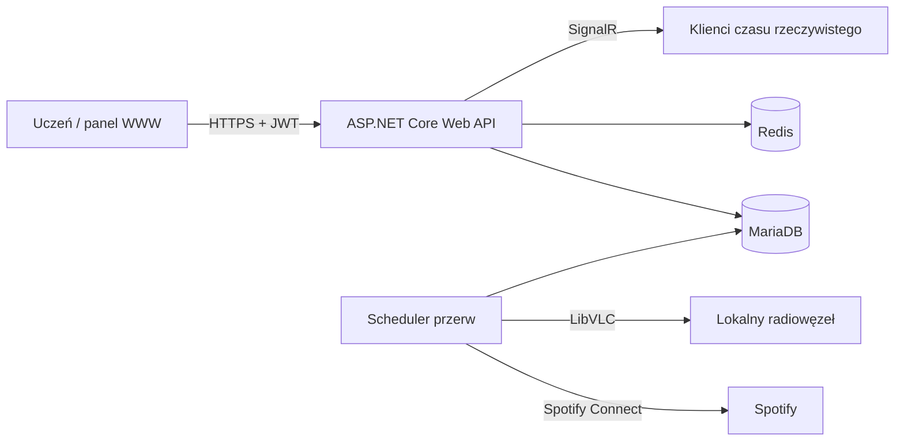

# SchoolMusic Backend

[](https://github.com/school-music/schoolmusic-backend/actions/workflows/ci.yml)
[](https://dotnet.microsoft.com/)
[](https://www.docker.com/)
[](https://mariadb.org/)
[](https://redis.io/)
[](http://localhost:8080/scalar/v1)

> **SchoolMusic** to kompleksowy, inteligentny system zarządzania radiowęzłem szkolnym. Projekt eliminuje chaos i subiektywizm tradycyjnych radiowęzłów, wprowadzając demokratyczne głosowanie na muzykę, automatyczną synchronizację z dzwonkami lekcyjnymi oraz dwuetapową moderację treści.

---

## Spis treści
- [O projekcie](#-o-projekcie)
- [Główne funkcjonalności](#-główne-funkcjonalności)
- [Architektura i przepływ](#-architektura-i-przepływ)
- [Technologie](#-stos-technologiczny)
- [Szybki start (Środowisko demonstracyjne)](#-szybki-start-środowisko-demonstracyjne)
- [Domyślne konta testowe](#-domyślne-konta-testowe)
- [Interaktywna dokumentacja API (Scalar)](#-interaktywna-dokumentacja-api-scalar)
- [Zmienne środowiskowe](#-zmienne-środowiskowe)
- [Uruchomienie w środowisku deweloperskim](#-uruchomienie-w-środowisku-deweloperskim)
- [Testy jednostkowe i integracyjne](#-testy-jednostkowe-i-integracyjne)
- [Materiały konkursowe](#-materiały-konkursowe)

---

## O projekcie

W wielu szkołach radiowęzeł jest obsługiwany ręcznie przez pojedyncze osoby, co prowadzi do monotonii muzycznej, spóźnień z wyłączaniem muzyki na lekcjach oraz ryzyka odtwarzania nieodpowiednich utworów.

**SchoolMusic** rozwiązuje te problemy poprzez:
1. **Demokratyczny wybór muzyki:** Uczniowie zgłaszają i wybierają utwory w aplikacji mobilnej.
2. **Precyzyjną automatyzację:** Serwer w tle zarządza odtwarzaniem, idealnie dopasowując utwory do długości przerw.
3. **Kulturalne środowisko szkolne:** Dwuetapowa moderacja (Zielona Lista zweryfikowanych utworów + panel weryfikacji w Redis) chroni szkołę przed wulgaryzmami.

---

## Główne funkcjonalności

* **Live Ranking i demokratyczne głosowanie:** Dynamiczne przeliczanie punktów z natychmiastowym rozgłaszaniem wyników przez WebSockets (**SignalR**).
* **Inteligentny harmonogram przerw (`BreakService`):** Algorytm zachłanny z mechanizmem *gap-fillera*, który optymalnie wypełnia czas przerwy i automatycznie wycisza dźwięk przed wejściem uczniów do klas.
* **Ochrona anty-monopolowa:** Utwór po odtworzeniu otrzymuje **24-godzinny cooldown** – zapobiega to zapętleniu tych samych hitów każdego dnia.
* **Hybrydowy silnik audio:**
  * **Spotify Connect API:** Odtwarzanie w najwyższej jakości bezpośrednio z licencjonowanego katalogu Spotify na urządzeniu szkolnym.
  * **LibVLCSharp:** Lokalny odtwarzacz zapasowy do dżingli, komunikatów dyrekcji oraz pracy w trybie offline.
* **Obsługa dni i przerw specjalnych:** Możliwość wyciszenia muzyki na czas egzaminów (`ExceptionDay`), apeli szkolnych (`ExceptionBreak`) lub zaplanowania audycji dyrekcji (`SpecialEvents`).
* **Analityka i statystyki w Redis:** Monitorowanie najpopularniejszych gatunków, artystów i aktywności uczniów.

---

## Architektura i przepływ



Scheduler działa w procesie API jako usługa w tle. Odczytuje harmonogram i kolejkę z MariaDB, a stan
odtwarzania utrzymuje w `PlaybackState`. Redis przechowuje cache statystyk oraz kolejkę propozycji oczekujących
na moderację. Klienci otrzymują zmiany kolejki i statusu przez SignalR.

### Macierz ról i endpointów

| Obszar | `user` | `mod` | `admin` | `head_admin` |
| :--- | :---: | :---: | :---: | :---: |
| Logowanie, profil, ulubione | ✔ | ✔ | ✔ | ✔ |
| Zgłaszanie i głosowanie | ✔ | ✔ | ✔ | ✔ |
| Panel moderacji i Greenlista | – | ✔ | ✔ | ✔ |
| Sterowanie odtwarzaniem i harmonogramem | – | – | ✔ | ✔ |
| Zarządzanie użytkownikami i konfiguracją | – | – | – | ✔ |

---

## Wykorzystane technologie

| Warstwa | Technologia | Opis |
| :--- | :--- | :--- |
| **Platforma** | `.NET 10.0` (C# 14) | Najnowsza, ultra-szybka platforma backendowa ASP.NET Core Web API |
| **Baza danych** | `MariaDB 10.4` | Relacyjna baza danych z mapowaniem przez Entity Framework Core |
| **Cache & Kolejki** | `Redis 7 Alpine` | Szybki cache rankingów, kolejka moderacji i blokady anty-spam |
| **Komunikacja Real-Time** | `SignalR (WebSockets)` | Natychmiastowa synchronizacja stanu odtwarzacza i kolejki |
| **Silnik Audio** | `SpotifyAPI.Web` / `LibVLCSharp` | Hybrydowe sterowanie Spotify Connect oraz lokalny silnik VLC |
| **Dokumentacja API** | `OpenAPI` + `Scalar.AspNetCore` | Nowoczesny, interaktywny interfejs testowania endpointów REST |
| **Konteneryzacja** | `Docker & Docker Compose` | Zapewnia powtarzalność i start całego stosu jedną komendą |
| **Testy i Jakość** | `xUnit`, `Moq`, `FluentAssertions` | 242 testy jednostkowe i integracyjne |
| **CI/CD** | `GitHub Actions` | Automatyczna budowa, testy pokrycia kodu i weryfikacja Dockera |

---

## Szybki start (Środowisko demonstracyjne)

Wszystkie usługi (API, baza danych MariaDB z wgranymi danymi demo oraz Redis) uruchamiają się **jedną komendą** przy użyciu Dockera.

### Wymagania wstępne
* Zainstalowany [Docker Desktop](https://www.docker.com/products/docker-desktop/) lub Docker Engine z wtyczką Compose.

### Uruchomienie:
1. Sklonuj repozytorium:
   ```bash
   git clone https://github.com/school-music/schoolmusic-backend.git
   cd schoolmusic-backend
   ```
2. Uruchom środowisko demonstracyjne:
   ```bash
   cp .env.example .env
   # Uzupełnij losowe hasła i klucz JWT w pliku .env
   docker compose -f docker-compose.yml -f docker-compose.dev.yml up -d
   ```
3. Poczekaj kilkanaście sekund na inicjalizację bazy MariaDB i start API.
4. **Gotowe!** System jest dostępny pod adresami:
   * **API Backend:** `http://localhost:8080`
   * **Interaktywna dokumentacja Scalar:** `http://localhost:8080/scalar/v1`
   * **Baza danych MariaDB:** `localhost:3306` (baza: `schoolmusic`, dane logowania z pliku `.env`)
   * **Redis Cache:** `localhost:6379`

Aby zatrzymać środowisko:
```bash
docker compose down
```

Aby wykonać czystą instalację (usunięcie bazy, cache Redis i nagrań, a następnie ponowne wczytanie
`docs/schoolmusic.sql`):
```bash
docker compose down -v
docker compose -f docker-compose.yml -f docker-compose.dev.yml up -d
```

Skrypt `docs/schoolmusic.sql` jest wykonywany wyłącznie przy tworzeniu pustego wolumenu MariaDB. Zmiany
schematu dla istniejącej bazy należy stosować plikami z [`docs/migrations`](docs/migrations/README.md).

> **Ważne:** scheduler przerw może działać tylko w jednej instancji API. Dodatkowe repliki należy uruchamiać
> z `Scheduler__Enabled=false`, aby nie rozpoczynały odtwarzania równolegle.

---

## Domyślne konta testowe

Baza demonstracyjna w kontenerze MariaDB (`docs/schoolmusic.sql`) jest wstępnie zainicjalizowana kontami o różnych poziomach uprawnień:

| Rola w systemie | Login | Hasło | Uprawnienia |
| :--- | :--- | :--- | :--- |
| **Head Admin** | `admin` | `Admin123!` | Pełne zarządzanie radiowęzłem, użytkownikami, harmonogramami i Spotify |
| **Moderator** | `moderator` | `Mod123!` | Dostęp do panelu moderacji utworów, blokowanie spamerów i Greenlisty |
| **Uczeń** | `uczen` | `Uczen123!` | Standardowe konto ucznia: zgłaszanie utworów, głosowanie, ulubione |

*Hasła w bazie danych są bezpiecznie zahashowane algorytmem **BCrypt**.*

> Konta demonstracyjne istnieją wyłącznie w bazie startowej `docs/schoolmusic.sql` i w profilu
> `docker-compose.dev.yml`. W środowisku produkcyjnym rejestracja lokalna jest wyłączona
> (`Auth__AllowLocalRegistration=false`), a powyższe hasła nie mogą być używane.

---

## Interaktywna dokumentacja API (Scalar)

Aplikacja wykorzystuje nowoczesny interfejs **Scalar** zintegrowany ze specyfikacją **OpenAPI v1**:
* **Adres interfejsu Scalar:** [http://localhost:8080/scalar/v1](http://localhost:8080/scalar/v1)
* **Surowy schemat OpenAPI:** [http://localhost:8080/openapi/v1.json](http://localhost:8080/openapi/v1.json)

> Scalar i endpoint OpenAPI są dostępne tylko w środowisku `Development` lub po jawnym ustawieniu
> `Features__SwaggerEnabled=true`. Domyślnie w produkcji są wyłączone.

### Jak testować zabezpieczone endpointy w Scalar:
1. W interfejsie Scalar przejdź do sekcji `Users` -> `POST /api/auth/login`.
2. Zaloguj się danymi konta `admin` (hasło: `Admin123!`).
3. Skopiuj zwrócony token JWT.
4. W prawym górnym rogu Scalar kliknij **Authorize / Authentication**, wybierz `Bearer` i wklej swój token.
5. Wszystkie chronione zapytania będą teraz automatycznie autoryzowane Twoim tokenem!

---

## Zmienne środowiskowe

Konfiguracja aplikacji zarządzana jest przez zmienne środowiskowe (zgodnie ze standardem *12-Factor App*):

| Zmienna środowiskowa | Wartość domyślna | Opis |
| :--- | :--- | :--- |
| `ASPNETCORE_ENVIRONMENT` | `Production` | Środowisko uruchomieniowe ASP.NET Core |
| `Features__SwaggerEnabled` | `false` | Aktywuje dokumentację Scalar / OpenAPI poza środowiskiem Development |
| `ConnectionString__database` | *(wymagana)* | Połączenie do MariaDB z dedykowanym użytkownikiem aplikacji |
| `ConnectionString__redis` | *(wymagana)* | Połączenie do Redis zabezpieczone hasłem |
| `Jwt__Key` | *(wymagana, min. 32 bajty)* | Klucz symetryczny do podpisywania tokenów JWT |
| `Jwt__Issuer` | `SchoolMusicAPI` | Wystawca tokenów JWT |
| `Jwt__Audience` | `SchoolMusicApp` | Odbiorca tokenów JWT |
| `Auth__AllowLocalRegistration` | `false` | Publiczna rejestracja kont lokalnych (włączana tylko w profilu demo) |
| `Scheduler__Enabled` | `true` | Czy ta instancja steruje automatycznym odtwarzaniem; tylko jedna instancja może mieć `true` |
| `School__TimeZone` | `Europe/Warsaw` | Strefa czasowa szkoły używana przez harmonogram i statystyki |
| `Spotify__ClientId` | *(opcjonalne)* | Identyfikator aplikacji Spotify Developer Dashboard |
| `Spotify__ClientSecret` | *(opcjonalne)* | Sekret aplikacji Spotify Developer Dashboard |
| `Spotify__RedirectUri` | `http://localhost:8080/api/spotify-playback/callback` | Callback autoryzacji Spotify OAuth |
| `Spotify__DeviceName` | `PA Spotify` | Nazwa urządzenia Spotify Connect radiowęzła |
| `Spotify__TokenEncryptionKey` | *(opcjonalne)* | Klucz szyfrowania zapisanego tokenu Spotify |

---

## Uruchomienie w środowisku deweloperskim

Jeśli chcesz rozwijać aplikację lokalnie na maszynie bez kontenera API:

1. Uruchom same usługi bazodanowe (MariaDB i Redis) z profilu deweloperskiego:
   ```bash
   docker compose -f docker-compose.yml -f docker-compose.dev.yml up -d db redis
   ```
2. Ustaw połączenia lokalne (np. przez `dotnet user-secrets`) i uruchom backend:
   ```bash
   dotnet user-secrets --project schoolmusic-backend set "ConnectionString:database" "server=localhost;port=3306;database=schoolmusic;user=schoolmusic;password=<hasło z .env>;"
   dotnet user-secrets --project schoolmusic-backend set "ConnectionString:redis" "localhost:6379,password=<hasło z .env>"
   dotnet run --project schoolmusic-backend
   ```
3. Aplikacja uruchomi się na adresach z `Properties/launchSettings.json`:
   `http://localhost:5170`, `http://localhost:5200` lub `https://localhost:7241`.
   W trybie `Development` brakujący `Jwt:Key` jest zastępowany losowym kluczem procesu, a logowanie LDAP
   działa w trybie symulowanym na kontach `jan.kowalski` / `anna.nowak` (hasło `SzkolaPassword123!`).

---

## Testy jednostkowe i integracyjne

Projekt posiada rozbudowany pakiet **242 zautomatyzowane testy** sprawdzających logikę algorytmów kolejkowania, harmonogramu, moderacji oraz autoryzacji:

```bash
# Uruchomienie wszystkich testów
dotnet test schoolmusic-backend.sln

# Uruchomienie testów z raportem pokrycia kodu (Coverage)
dotnet test --collect:"XPlat Code Coverage"
```

Każdy Pull Request oraz push do gałęzi `main` jest automatycznie testowany przez potok **GitHub Actions CI**.

---

## Logowanie kontami szkolnymi (LDAP / Active Directory)

System **SchoolMusic** umożliwia logowanie uczniów bezpośrednio ich kontami ze szkolnego katalogu komputerowego (Active Directory / OpenLDAP) z mechanizmem automatycznego tworzenia kont (**JIT provisioning**).

**Dedykowany przewodnik dla administratora szkoły:** Szczegółowe instrukcje, parametry i kwestionariusz znajdują się w [docs/LDAP_INTEGRATION_GUIDE.md](docs/LDAP_INTEGRATION_GUIDE.md).
**Lokalny serwer OpenLDAP do testów:** Możliwość uruchomienia gotowego kontenera LDAP z testowymi kontami uczniów:
  `docker compose -f docker-compose.yml -f docker-compose.ldap.yml up -d`
  Konta testowe w OpenLDAP:
  - jan.kowalski / SzkolaPassword123!
  - anna.nowak / SzkolaPassword123!

---
## Materiały konkursowe

**Konspekt prezentacji przed komisją:** Szczegółowe omówienie 10 punktów regulaminowych (Sekcje 14 i 15) znajduje się w pliku [`docs/PREZENTACJA.md`](docs/PREZENTACJA.md).
**Schemat bazy danych demo:** Gotowy plik inicjalizacyjny SQL znajduje się w [`docs/schoolmusic.sql`](docs/schoolmusic.sql).

---

## Licencja

Repozytorium nie zawiera obecnie pliku `LICENSE`. Warunki wykorzystania i publikacji kodu należy ustalić
przed udostępnieniem projektu poza szkołą.
