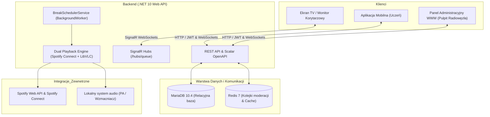
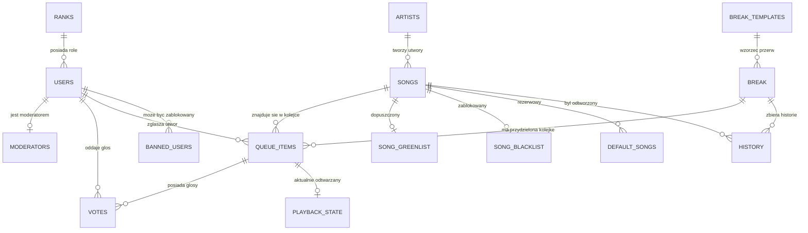
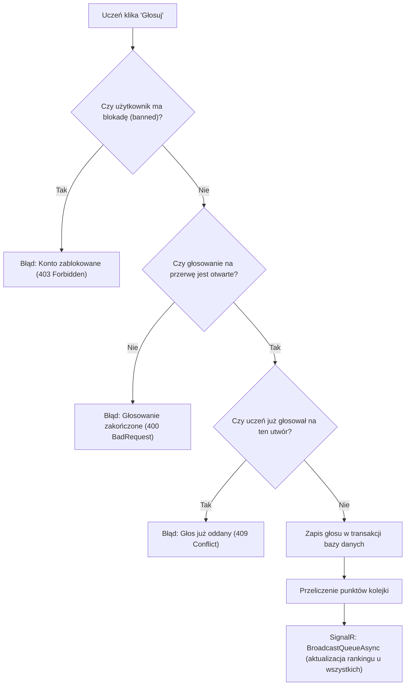
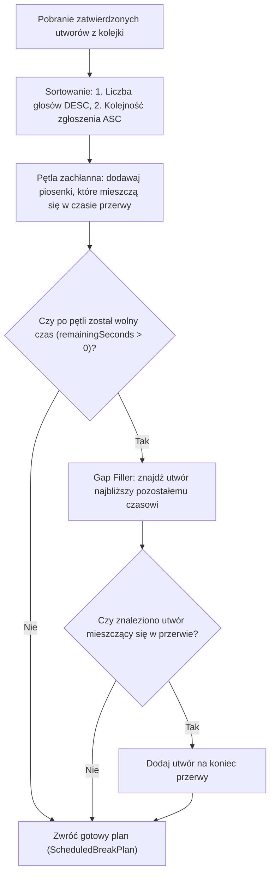

# Konspekt Prezentacji Konkursowej: SchoolMusic

**Projekt:** SchoolMusic – Inteligentny, Demokratyczny Radiowęzeł Szkolny  
**Komponent:** Backend REST API (.NET 10 / Docker / MariaDB / Redis / SignalR)  
**Dokumentacja konkursowa:** Zgodna z wymogami Sekcji 14 i 15 Regulaminu Konkursu  
**Sugerowany czas prezentacji:** 15 minut + 5 minut sesji pytań i odpowiedzi (Q&A)

---

## Sugerowany scenariusz i podział czasowy wystąpienia

| Czas | Slajd / Zagadnienie | Prowadzący | Kluczowy przekaz |
| :--- | :--- | :--- | :--- |
| **0:00 - 1:30** | 1. Pomysł i cel projektu | Lider / Speaker | Dlaczego radiowęzły w szkołach nie działają i jak to zmieniamy. |
| **1:30 - 3:00** | 2. Architektura systemu | Architekt / Backend | Trzy filary: .NET 10 API, Redis (cache/kolejki), MariaDB (dane trwał). |
| **3:00 - 4:30** | 3. Projekt bazy danych | Baza danych / Backend | Relacje, ograniczenia integralności, optymalizacja zapytań. |
| **4:30 - 6:00** | 4. Aplikacja serwerowa (Backend) | Główny programista | .NET 10, C# 14, bezpieczeństwo JWT, SignalR, 245 testów jednostkowych. |
| **6:00 - 7:30** | 5. Panel administracyjny WWW | Frontend / Web dev | Pełna kontrola dla dyrekcji i radiowęzłowców (dźwięk, plany, blokady). |
| **7:30 - 9:00** | 6. Aplikacja mobilna | Mobile dev | Narzędzie w rękach ucznia: szybkie głosowanie, podgląd na żywo. |
| **9:00 - 10:30**| 7. Mechanizm głosowania | Backend dev | Demokratyczny algorytm rankingowy, anty-spam, cooldown 24h. |
| **10:30 - 12:00**| 8. Harmonogram przerw | Backend dev | Automatyzacja dzwonków, szablony dni, obsługa apeli i egzaminów. |
| **12:00 - 13:30**| 9. Kolejka odtwarzania | Algorytmik / Backend | Algorytm zachłanny, gap-filler, fallback na utwory domyślne. |
| **13:30 - 15:00**| 10. Źródła muzyki & Demo na żywo | Cały zespół | Spotify Connect + LibVLC, zielona/czarna lista, podsumowanie. |

---

## 1. Pomysł i cel projektu

### Geneza problemu
Tradycyjny radiowęzeł szkolny w większości polskich szkół cierpi na trzy fundamentalne wady:
1. **Monopol i subiektywność:** Muzykę puszcza wąska grupa uczniów (lub pojedyncza osoba), narzucając swój gust całej szkole.
2. **Brak kontroli nad czasem i dzwonkami:** Muzyka często gra po dzwonku na lekcję, zakłócając zajęcia, lub nie gra wcale z powodu spóźnienia radiowęzłowca.
3. **Ryzyko nieodpowiednich treści:** Przypadkowe lub celowe odtworzenie utworów z wulgaryzmami naraża szkołę na konsekwencje wychowawcze.

### Misja i cel systemu SchoolMusic
* **Demokratyzacja muzyki:** Każdy uczeń może zaproponować piosenkę i zagłosować na utwory innych.
* **100% automatyzacji:** System sam startuje utwory wraz z dzwonkiem na przerwę i płynnie wycisza dźwięk przed wejściem uczniów do klas.
* **Bezpieczeństwo i moderacja:** Dwuetapowa weryfikacja (automatyczna Greenlista z weryfikacją Spotify + szybki panel moderatorski dla samorządu).

---

## 2. Architektura systemu

System SchoolMusic został zaprojektowany w oparciu o architekturę zorientowaną na usługi, skonteneryzowaną w Dockerze:

### Kluczowe komponenty:
* **ASP.NET Core Web API (.NET 10):** Szybki, bezstanowy silnik obsługujący logikę biznesową i uprawnienia.
* **SignalR (WebSockets):** Dwukierunkowa transmisja w czasie rzeczywistym – każda zmiana w rankingu czy głośności jest natychmiast widoczna na telefonach uczniów i ekranach w szkole.
* **Redis 7:** Szybki cache wyników, kolejki propozycji do moderacji (`proposals:pending`) oraz blokady anty-spam.
* **MariaDB 10.4:** Bezpieczny relacyjny magazyn użytkowników, historii, harmonogramów i utworów.

---

## 3. Projekt bazy danych

Projekt bazy danych odzwierciedla rygorystyczne wymagania spójności danych i optymalizacji pod kątem zapytań o ranking w czasie rzeczywistym.

### Najważniejsze założenia bazy:
1. **Unikalność w ramach przerwy:** Unikalny indeks `uniq_break_song` zapobiega ponownemu dodaniu tej samej piosenki na tę samą przerwę.
2. **Integralność głosowania:** Klucz unikalny `uniq_user_queue_vote` na parze `(user_id, queue_item_id)` gwarantuje na poziomie silnika bazy, że żaden uczeń nie zagłosuje dwa razy na ten sam utwór.
3. **Wydajne indeksy:** Indeksy na `start_at` w tabeli `break` oraz na flagach `is_active` i relacjach kluczy obcych zapewniają czas odpowiedzi poniżej 5 ms.

---

## 4. Aplikacja serwerowa (Backend)

Backend został zaimplementowany przy użyciu platformy **.NET 10** z zachowaniem najwyższych standardów inżynierii oprogramowania:

* **Zasady SOLID i Dependency Injection:** Każda odpowiedzialność wydzielona do dedykowanego interfejsu (`IBreakService`, `IQueueService`, `IAudioPlayerService`, `ISpotifyConnectPlaybackService`).
* **Wzorzec `ServiceResult<T>`:** Spójna obsługa wyników biznesowych i błędów HTTP (Ok, Created, BadRequest, NotFound, Forbidden, Conflict) bez rzucania kosztownych wyjątków w standardowym przepływie.
* **Autoryzacja RBAC (Role-Based Access Control):** 4 poziomy uprawnień:
  * `user`: uczeń (zgłaszanie, głosowanie, ulubione).
  * `mod`: moderator (zatwierdzanie/odrzucanie propozycji, blokowanie spamerów).
  * `admin`: radiowęzłowiec (pełna kontrola playbacku, głośności, harmonogramu).
  * `head_admin`: administrator systemu (zarządzanie kontami i konfiguracją).
* **Automatyczne testy jakościowe:** 245 testów jednostkowych i integracyjnych (xUnit, Moq, InMemoryDatabase), weryfikujących logikę harmonogramu, moderację, kolejkowanie i bezpieczeństwo.

---

## 5. Panel administracyjny WWW

Panel administracyjny stanowi centrum dowodzenia radiowęzłem dla operatorów i opiekunów szkolnych:

> Uzupełnić po tym jak skończymy backend

---

## 6. Aplikacja mobilna

Dedykowana aplikacja na smartfony uczniów umożliwia aktywny udział w życiu szkoły:

> Uzupełnić po tym jak skończymy aplikacje

---

## 7. Mechanizm głosowania

Mechanizm głosowania został zaprojektowany tak, aby promować najlepszą muzykę i całkowicie wykluczyć nadużycia (anty-spam / anty-bot):

### Ochrona przed monopolem utworów (24h Cooldown):
Gdy utwór zostanie odtworzony na danej przerwie, system rejestruje ten fakt w tabeli `history`. Przez kolejne **24 godziny** utwór ten nie może zostać ponownie zgłoszony ani przegłosowany. Zapobiega to puszczaniu w kółko tych samych hitów każdego dnia.

---

## 8. Harmonogram przerw

Harmonogram przerw odpowiada za bezwzględne przestrzeganie dyscypliny czasu lekcyjnego w szkole:

* **Szablony tygodniowe (`BreakTemplates`):** Standardowy plan lekcji (np. 45 min lekcja, 10 min przerwa, 15 min duża przerwa obiadowa).
* **Elastyczność dni (`WeeklySchedule`):** Odrębne plany dla poszczególnych dni tygodnia (np. lekcje skrócone do 30 minut przed świętami).
* **Dni Wyjątkowe (`ExceptionDay`):** Pełne wyciszenie muzyki na cały dzień (np. egzaminy ósmoklasisty, matury, żałoba narodowa).
* **Przerwy Wyjątkowe (`ExceptionBreak`):** Wyciszenie konkretnej pojedynczej przerwy (np. uroczysty apel, akademia w auli).
* **Zabezpieczenie przed dzwonkiem:** Głosowanie zamyka się na minutę przed przerwą (`VoteEnds = StartAt - 1 min`), co daje serwisowi czas na optymalne przeliczenie kolejki przed dzwonkiem.
* **Jawna strefa czasowa szkoły:** Harmonogram i wydarzenia używają `School__TimeZone` (domyślnie `Europe/Warsaw`), niezależnie od strefy systemu kontenera. Znaczniki techniczne (głosy, historia, stan odtwarzania) są zapisywane w UTC.
* **Jedna instancja sterująca:** Automatyczne odtwarzanie uruchamia tylko instancja z `Scheduler__Enabled=true`. Dodatkowe repliki API powinny mieć tę opcję wyłączoną.

---

## 9. Kolejka odtwarzania

Serwis [`BreakService`](../schoolmusic-backend/Services/BreakService.cs) implementuje dedykowany algorytm selekcji utworów:

1. **Priorytet demokracji:** Piosenka z największą liczbą głosów zawsze gra jako pierwsza.
2. **Optymalne upakowanie czasu:** Jeśli po dodaniu hitów zostaje np. 3 minuty i 10 sekund, system przeszukuje dalsze miejsca kolejki, aby znaleźć utwór, który wypełni ten czas i skończy się idealnie przed dzwonkiem.
3. **Fallback Failsafe:** Jeśli uczniowie nie zgłosili żadnej piosenki na przerwę, serwis automatycznie sięga po utwory z puli `DefaultSongs`, więc radiowęzeł nigdy nie milczy niespodziewanie.

---

## 10. Źródła muzyki

SchoolMusic obsługuje dwa komplementarne silniki odtwarzania dźwięku:

### 1. Spotify Connect API
* **Działanie:** Backend łączy się ze szkolnym kontem Spotify Premium za pomocą protokołu OAuth 2.0 (token odświeżany automatycznie w tle).
* **Sterowanie:** Serwer instruuje urządzenie odtwarzające (np. komputer podpięty pod szkolny wzmacniacz), co i z jaką głośnością ma odtwarzać.
* **Jakość i legalność:** Gwarancja najwyższej jakości dźwięku i dostęp do milionów licencjonowanych utworów.

### 2. LibVLCSharp (Lokalny odtwarzacz)
* **Działanie:** Wykorzystuje silnik VLC do bezpośredniego odtwarzania plików MP3, dżingli szkolnych oraz audycji z dysku lub URL.
* **Niezależność:** W przypadku awarii łącza internetowego radiowęzeł nadal może odtwarzać komunikaty i muzykę zapisaną lokalnie.

### Bezpieczeństwo treści: Greenlista i Blacklista
* **Greenlista:** Baza zweryfikowanych, kulturalnych utworów. Gdy uczeń zgłasza piosenkę z Greenlisty, trafia ona do kolejki **automatycznie** w ułamku sekundy.
* **Nowe zgłoszenia:** Utwory spoza listy trafiają do szybkiej kolejki moderatora w Redis. Moderator jednym kliknięciem w telefonie decyduje: *Zatwierdź* lub *Odrzuć*.
* **Blacklista:** Stała blokada wykonawców i piosenek zawierających wulgaryzmy lub treści nieodpowiednie dla szkoły.

---

## Podsumowanie i gotowość na pytania komisji

| Częste pytanie komisji | Odpowiedź zespołu SchoolMusic |
| :--- | :--- |
| **"Co jeśli internet przestanie działać?"** | System posiada lokalny silnik LibVLCSharp oraz bazę `DefaultSongs` na dysku – dzwonki i muzyka lokalna działają bez sieci. |
| **"Czy uczeń może 'zhakować' głosy botem?"** | Głosowanie wymaga konta JWT, a unikalność głosu wymusza indeks bazy danych. Operacje tej samej przerwy są serializowane, a równoległy zapis kończy się kontrolowanym błędem 409 zamiast zdublowanym głosem. |
| **"Co jeśli dzwonek zadzwoni w połowie piosenki?"** | Algorytm `BreakService` precyzyjnie planuje utwory na długość przerwy, a serwis tła wycisza dźwięk (fade-out) dokładnie z sekundą zakończenia przerwy. |
| **"Jak łatwo wdrożyć to w innej szkole?"** | Wdrożenie sprowadza się do uzupełnienia `.env` i uruchomienia `docker compose -f docker-compose.yml -f docker-compose.dev.yml up -d`. Całość wstaje z gotową bazą i kontami demonstracyjnymi. |
